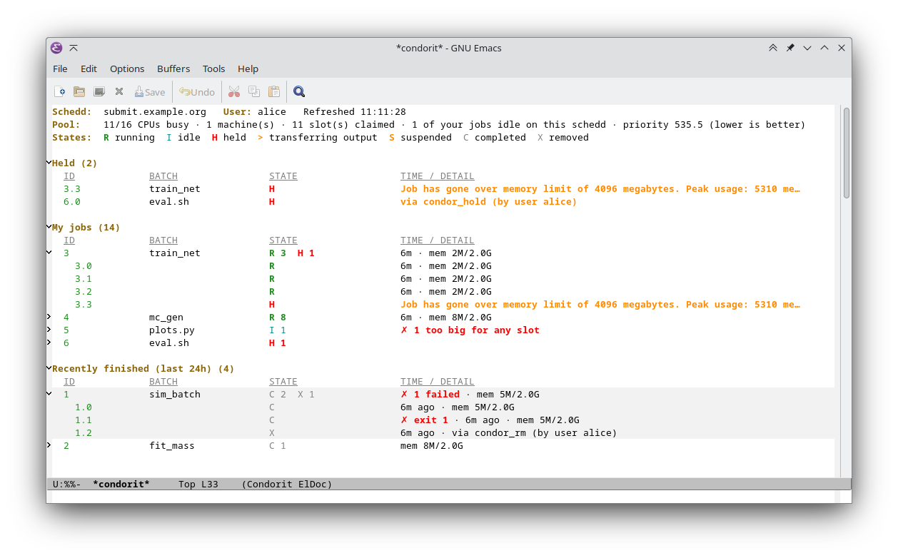

# condorit

I realised, thanks to magit, I dont know the git CLI, so why should I
learn it for condor either..?

So I had Claude build the Magit clone, and I learn the condor CLI
through it. I've been using it live for a couple of days and its fine
for now. Thanks to the [Magit](https://magit.vc/) project for the idea, the interface,
and years of not having to remember git flags.

A Magit-like Emacs interface to [HTCondor](https://htcondor.org/):
**condor** + mag**it**.

- One buffer with your held jobs (and why), your queue grouped by cluster,
  recently finished jobs, and a pool summary.
- Every action is a transient menu showing the exact `condor_*` command it
  will run, and every command run is logged in `$`. You learn the CLI by
  using the UI.
- `C-h` followed by a flag's key in any menu opens the man page at that
  flag. Moving onto a job explains its state in the echo area.



## Install

Requires Emacs ≥ 29.1, `transient` and `magit-section`. Both come with Magit,
so if you use Magit you already have them; otherwise install them from MELPA.

### Quick start

On Emacs 30 or later, `use-package` can fetch it from GitHub:

```elisp
(use-package condorit
  :vc (:url "https://github.com/dhohn/condorit" :lisp-dir "lisp")
  :commands (condorit condorit-submit)
  :bind (("C-c j" . condorit)))
```

On Emacs 29, install it once with
`M-: (package-vc-install '(condorit :url "https://github.com/dhohn/condorit" :lisp-dir "lisp"))`,
then use the same `use-package` form without the `:vc` line.

From a clone instead, use `:load-path "/path/to/condorit/lisp"` in place of
the `:vc` line.

Then `C-c j` (or `M-x condorit`) on a machine where `condor_q` works opens
your jobs; `?` in that buffer shows everything else. Running Emacs on your
laptop? `C-u M-x condorit` and enter `/ssh:login-node:` to use the schedd there
(see [Remote hosts](#remote-hosts-tramp)). Without `use-package`:

```elisp
(add-to-list 'load-path "/path/to/condorit/lisp")
(require 'condorit)
```
## Keys

| Key | Action |
|---|---|
| `g` | refresh |
| `?` / `h` | the keys and options of this view (`-allusers`, `-constraint`, `-global`, …) |
| `RET` | full ClassAd of the job at point (on a cluster: fold/unfold) — status, history; of the machine or slot at point — pool |
| `o` | sort the job lists by id, name, time, memory or an extra column; `o RET` reverses the current order — status, history |
| `l` | open the event log, stdout or stderr, or follow a running job's output (`l O` / `l E`) — status, history |
| `a` | why isn't it running? (`condor_q -better-analyze`) — status |
| `k` / `H` / `R` | remove / hold / release the job, cluster or region — status |
| `e` | edit an attribute (`condor_qedit`) — status |
| `S` | shell inside the running job, on its execute node (`condor_ssh_to_job`) — status |
| `s` | submit a `.sub` file (with dry-run) |
| `t` | history (`condor_history`) |
| `P` | machines and slots: free CPUs and GPUs per machine; unfold one for its hardware, OS, site attributes and jobs (`?` → only free CPUs/GPUs, only my jobs, `-constraint`, group by GPU, CPU or OS) |
| `U` | users and priorities, and which schedds have jobs (`?` → `-a` includes idle users) |
| `$` | command log |

Idle jobs bigger than every slot are marked `✗ fits no slot` without asking.
In the status view, `-global` adds the jobs of every schedd in the pool,
grouped by schedd, and the job keys act on them there.

When you type a `-constraint`, `M-n` offers expressions built from the row at
point, `TAB` completes attribute names (with their units), and `RET` first
shows how many jobs or slots the expression matches.

## Configuration

Everything works without configuration. These are all the options, set to
example values (the comments give the defaults); copy the ones you want:

```elisp
(with-eval-after-load 'condorit
  ;; Refresh visible status buffers every minute (default nil: only on g).
  (setopt condorit-auto-refresh-interval 60)
  ;; How to report jobs that became held or clusters that finished
  ;; (default: a message in the echo area; `ignore' turns it off).
  (require 'notifications)
  (setopt condorit-notify-function
          (lambda (text) (notifications-notify :title "condorit" :body text)))
  ;; Extra job columns, before TIME / DETAIL (default none).
  (setopt condorit-job-columns
          '(("RemoteHost" "HOST" 36)
            ("RemoteWallClockTime" "WALL" 6 right condorit-classad-format-duration)))
  ;; "Recently finished": how far back, and at most how many jobs
  ;; (defaults 24 hours and 1000).
  (setopt condorit-history-window (* 3 24 3600)
          condorit-history-limit 1000)
  ;; Highlight peak memory from this share of the request on (default 0.9).
  (setopt condorit-memory-warning 0.8)
  ;; Hide the line explaining the state letters (default t).
  (setopt condorit-show-legend nil)
  ;; Remove jobs without asking (default t: ask).
  (setopt condorit-confirm-remove nil)
  ;; Attributes `e' offers for completion; any other can be typed in.
  (setopt condorit-edit-attributes '("RequestMemory" "RequestCpus" "RequestDisk" "JobPrio"))
  ;; Site-specific machine attributes shown in the pool view (default none).
  (setopt condorit-pool-site-attributes '("HasSingularity" "HasDocker")))
```

`M-x customize-group RET condorit` lists the same options, and the faces.
The sections below explain the bigger ones.

## Remote hosts (TRAMP)

condorit runs condor commands on the host of `default-directory`, so it works
over TRAMP:

- `C-u M-x condorit` asks for a directory: enter e.g. `/ssh:login-node:` to use
  the schedd there. Each host gets its own status buffer, so several can be
  open at once.
- `M-x condorit` from any buffer visiting a remote file or directory uses that
  host.
- To always use one host, set `condorit-default-directory`, e.g.
  `(setq condorit-default-directory "/ssh:login-node:")`. Plain `M-x condorit`
  then opens that host from any buffer; `C-u M-x condorit` still asks.
- Log, stdout and stderr files (`l`) open remotely.

For speed, enable TRAMP's direct async processes for your hosts and let ssh
share one connection (the TRAMP manual recommends both together):

```elisp
(connection-local-set-profile-variables
 'remote-direct-async-process '((tramp-direct-async-process . t)))
(connection-local-set-profiles
 '(:application tramp :protocol "ssh") 'remote-direct-async-process)
```

```
# ~/.ssh/config
Host *
  ControlMaster auto
  ControlPath ~/.ssh/control-%C
  ControlPersist 10m
```

A remote refresh runs all its condor commands in one shell, so it costs a
single ssh session; the command log (`$`) still lists each command on its
own. Direct async makes that session start quickly; without it, TRAMP's
start-up of a process sometimes takes about 5 s.

### Troubleshooting: stuck on "Refreshing…"

If a remote refresh never finishes, check the remote shell startup files.
TRAMP logs in with `TERM=dumb` and expects a plain shell; a `~/.bashrc` that
starts another shell (e.g. a last line `/bin/zsh`) makes TRAMP's extra logins
for background processes hang. Skip it for TRAMP:

```sh
if [ "$TERM" != dumb ]; then /bin/zsh; fi
```

Then close the stale connection (`M-x tramp-cleanup-connection`) and refresh.

### Look

Colors come from faces that inherit from your theme (`success`, `error`,
`warning`, `shadow`, …), so they follow light and dark themes. Change any of
them with `M-x customize-group RET condorit`. Once you know the state letters,
hide the legend line (`condorit-show-legend`); the legend stays in the `?`
menu.

### Memory

Running and completed jobs show their peak memory against their request,
e.g. `mem 3.8G/4.0G`. From 90% of the request on it is highlighted, since
condor holds jobs that use more than they requested; change that with
`condorit-memory-warning`.

### Job columns

Add job attributes as columns, between STATE and TIME / DETAIL, in every job
list (`condorit-job-columns`, example above). Each is `(ATTRIBUTE TITLE WIDTH
[ALIGN [FORMAT]])`; a cluster row shows the value its jobs share, or `…`.

### Notifications

The status view tells you when your jobs change: after each refresh it
reports jobs that became held and clusters whose jobs finished, e.g.
`condorit: cluster 1240 done (4 completed, 1 failed)`. To get these without
pressing `g`, refresh on a timer (`condorit-auto-refresh-interval`), and send
them to the desktop with `condorit-notify-function`, as in the example above.

### Terminal

`S` runs `condor_ssh_to_job` in the built-in `term`, also on a remote host
through TRAMP. To use another terminal, set `condorit-terminal-function`; it
gets a buffer name, the program and its arguments, and must run the program
on the host of `default-directory`.

### Site attributes

Sites often advertise their own machine attributes, e.g. which container
runtimes a machine has. List the ones you care about in
`condorit-pool-site-attributes` and the pool view shows them under each
machine.

## Development

```
make test
```

The tests use fixtures and a fake condor (`test/bin`); no cluster needed.
Among them, `test/fixtures/versions/` holds what real HTCondor versions
print for every view, recorded from a small pool in the `htcondor/mini`
image (needs apptainer):

```
make record TAG=25.0.13-el9
```
